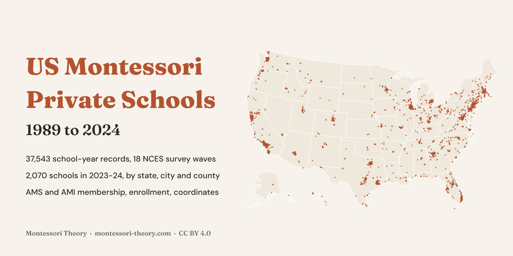
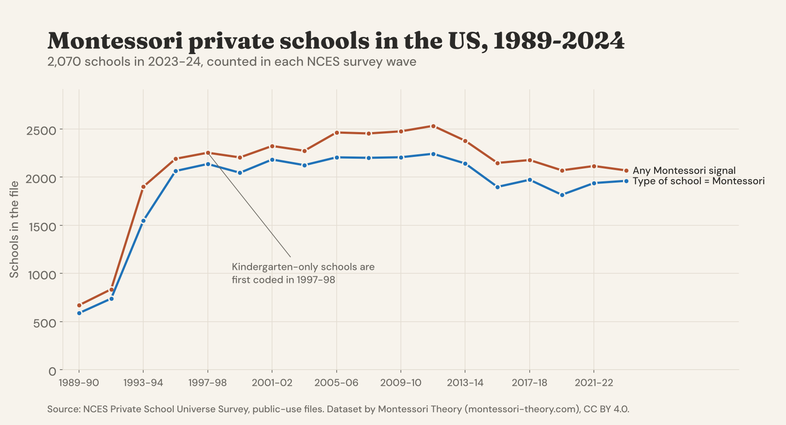
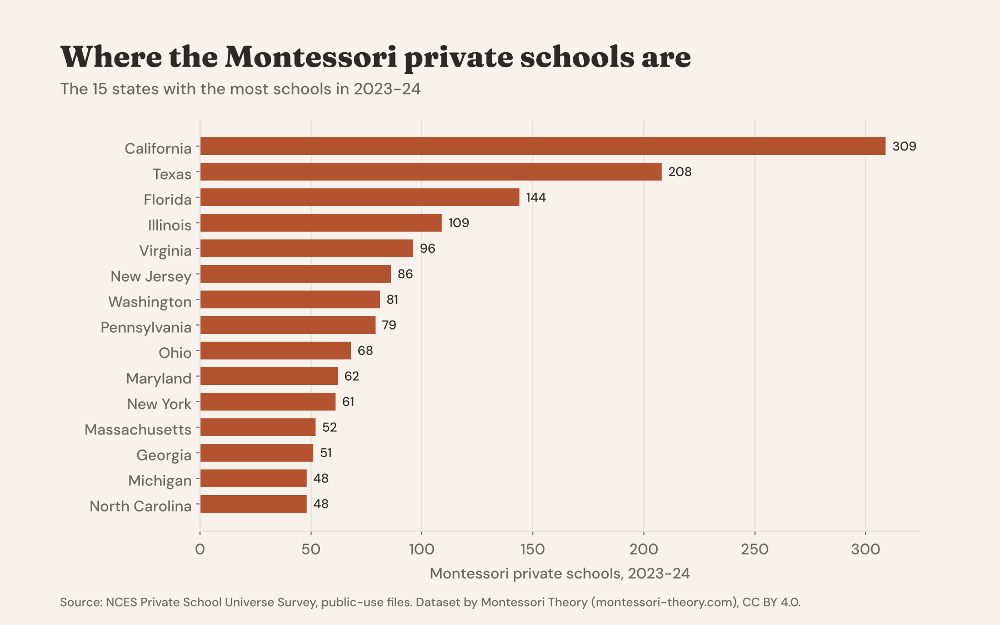
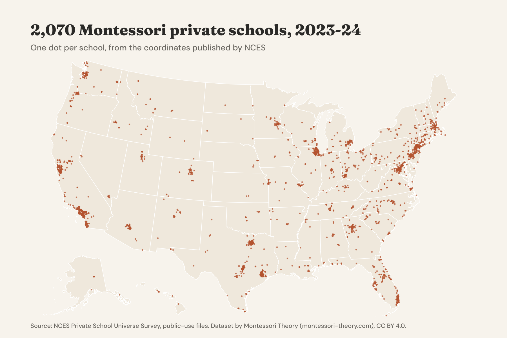

# US Montessori Private Schools, 1989-2024



**English first, version française plus bas, resumen en español al final.**

## Every Montessori Private School In The NCES Survey, Wave By Wave Since 1989

How many Montessori private schools are there in the United States, where are they, and which ones belong to AMS or AMI? This dataset answers with the official source. It pulls every Montessori school out of the **18 waves of the NCES Private School Universe Survey (PSS)**, from 1989-90 to 2023-24, into **37,543 school-year records** with one consistent set of columns, then adds ready-made tables by year, state, city, county and locale, and a map file for the latest wave.

In **2023-24** the survey counts **2,070 Montessori private schools** in all 50 states and DC. About **9 in every 100 private schools** in the file are Montessori. They sit mostly in suburbs (940) and cities (845), and enroll about **97,000 students from kindergarten up** and **99,000 prekindergarten children**.

### The Headline Numbers

|  |  |
|---|---|
| Montessori private schools, 2023-24 | 2,070 in the file (1,962 report "Montessori" as their type of school) |
| NCES weighted estimate, 2023-24 | 2,378 Montessori schools |
| Share of private schools in the file | 9.2 % |
| AMS members / AMI members, 2023-24 | 996 / 373 |
| Most schools | California 309, Texas 208, Florida 144, Illinois 109, Virginia 96 |
| Most schools in one city | Houston 28, Austin 21, Chicago 19, Portland 17, Irvine 16 |
| Biggest change since 2013-14 | Texas +45, Pennsylvania -58, California -47 |
| Students, 2023-24 | 97,311 kindergarten to grade 12, 99,369 prekindergarten |
| Typical school | 22 students from kindergarten up, 4.5 full-time teachers |



The count has stayed between about 2,000 and 2,500 schools for 25 years, with a peak of 2,533 in 2011-12. The low numbers before 1995 are mostly a change in what the survey covered, see Read With Care below.





### Files

| file | content |
|---|---|
| `data/montessori_private_schools_1989_2024.csv` | 37,543 rows, one per school and survey wave |
| `data/montessori_private_schools_2023_24.csv` | 2,070 rows, the latest wave only, with names and coordinates |
| `data/montessori_private_schools_2023_24.geojson` | the same 2,070 schools as map points |
| `data/national_by_year.csv` | 18 rows, national totals for each wave, weighted estimate and share of all private schools |
| `data/by_state_and_year.csv` | schools, memberships and enrollment by state and wave |
| `data/by_state_2023_24.csv` | 51 rows, states ranked, with the change since 2013-14 |
| `data/by_city_2023_24.csv` | 1,230 cities with at least one school, 2023-24 |
| `data/by_county_2023_24.csv` | 570 counties (5-digit FIPS), 2023-24 |
| `data/by_locale_and_year.csv` | city, suburb, town and rural counts by wave |
| `data/private_school_universe_totals.csv` | all private schools in each PSS file, the denominator |
| `data_dictionary.csv` | every column of every file |
| `scripts/` | the code that rebuilds everything from the NCES files |
| `notebooks/starter.ipynb` | a starter notebook with the charts above |

### Columns

**montessori_private_schools_1989_2024.csv**

| column | description |
|---|---|
| `survey_year` | PSS wave, school year (1989-90 to 2023-24, every two years) |
| `school_year_end` | Second year of the school year, as a number (1990 to 2024) |
| `school_id` | NCES private school id (PPIN). Stable across waves from the mid-1990s |
| `school_name` | School name, published by NCES from 2005-06 only |
| `city`, `state`, `state_name`, `zip5` | Location as published by NCES |
| `county_fips` | 5-digit county FIPS code, when NCES gives the county |
| `latitude`, `longitude` | School coordinates, from 2005-06 |
| `locale_group` | City, Suburb, Town or Rural |
| `locale_detail` | NCES 12-category locale (City, large ... Rural, remote), from 2005-06 |
| `program_type` | Type of school chosen by the school (Montessori, Regular, Early childhood...) |
| `religious_typology` | NCES 9-category typology (Catholic, other religious, nonsectarian) |
| `religious_or_nonsectarian` | The same, in two groups |
| `level` | Elementary, Secondary, or Combined |
| `lowest_grade`, `highest_grade` | Grade span, harmonized across waves |
| `prek_offered`, `kindergarten_offered` | The school offers prekindergarten / kindergarten (from 1995-96) |
| `students_k12` | Students from kindergarten to grade 12 plus ungraded (NCES NUMSTUDS) |
| `students_prek`, `students_kindergarten` | Prekindergarten and kindergarten enrollment (from 1995-96) |
| `teachers_fte_k12` | Full-time-equivalent teachers (NCES NUMTEACH) |
| `survey_weight` | NCES final weight. Sum it to get national estimates. Empty before 1995-96 |
| `montessori_program_type` | The school chose "Montessori" as its type of school |
| `ams_member` | Member of the American Montessori Society |
| `ami_member` | Member of the Association Montessori Internationale (asked from 2005-06) |
| `other_montessori_member` | Member of another Montessori association |
| `name_has_montessori` | The school name contains "Montessori" (from 2005-06) |
| `montessori_any` | At least one of the five flags above, always true in this file |

The other files are described column by column in `data_dictionary.csv`.

### Load It

```python
import pandas as pd

base = "https://raw.githubusercontent.com/montessoritheory/us-montessori-private-schools/main/data"
schools = pd.read_csv(f"{base}/montessori_private_schools_2023_24.csv")
schools.groupby("state").size().sort_values(ascending=False).head(10)

trend = pd.read_csv(f"{base}/national_by_year.csv")
trend[["survey_year", "montessori_schools", "weighted_estimate_program_type"]]
```

### How It Was Built

The public-use files of all 18 PSS waves were downloaded from the [NCES PSS data page](https://nces.ed.gov/surveys/pss/pssdata.asp) in October 2026 (SAS files for 1989-90 to 2011-12, CSV files from 2013-14). Variable names change from one wave to the next, so each wave was mapped with its own NCES label and format programs (`scripts/build_from_pss.py`). A school is kept when at least one Montessori signal is present: the type of school is Montessori, the school reports AMS, AMI or another Montessori association, or its name contains "Montessori". Grade codes were harmonized to one list, state FIPS codes in 1989-90 were turned into postal codes, and nothing was estimated or filled in. `scripts/make_outputs.py` builds the summary tables, the GeoJSON and the charts.

### Checked Against The Source

- **The weighted Montessori estimate matches NCES.** For 2021-22, `weighted_estimate_program_type` gives **2,441** Montessori schools, the exact figure in [NCES PSS Table 16, 2021-22](https://nces.ed.gov/surveys/pss/tables/TABLE16fl2122.asp) (program emphasis, Montessori).
- **The denominator matches NCES.** The weighted total of all private schools rebuilt from the files is identical to the national figure in [NCES Digest of Education Statistics Table 214.10](https://nces.ed.gov/programs/digest/d18/tables/dt18_214.10.asp) for all ten waves from 1997-98 to 2015-16 (for example 33,895 in 1997-98 and 34,576 in 2015-16), and to the 29,727 of 2021-22 in the PSS table above. The 1995-96 file gives 34,934, slightly above the published 34,394.
- **School records match the NCES Private School Search.** 25 records drawn at random from 2023-24 were compared with their NCES school page. Name and enrollment matched for all 22 pages that showed an enrollment figure.
- Every state, city and county total in the summary files adds up to the national total of its wave.

### Read With Care

- **Private schools only.** Public Montessori schools (district and charter) are not in the PSS and not in this dataset.
- **Schools that start at kindergarten or above.** The PSS covers schools that offer kindergarten or a higher grade. A Montessori program that only serves children under 5 is not in the survey.
- **Coverage changed in the early waves.** No school is coded as kindergarten-only before 1997-98, and the first two waves have no weights, no prekindergarten counts and fewer schools. Compare trends from 1995-96 on.
- **Counts versus estimates.** `montessori_schools` counts the records in each public file. The NCES national estimate uses the survey weights and is in `weighted_estimate_program_type` (from 1995-96). The 1993-94 weights sum to about 100,800 schools against 26,093 published by NCES, so they were left out, and the 2015-16 Montessori estimate (3,449) is unusually high.
- **Self-reported Montessori.** "Montessori" is the school's own answer. It does not mean AMS or AMI accreditation, and a member school is not necessarily accredited. Our guide to [AMI vs AMS](https://www.montessori-theory.com/ami-vs-ams-montessori-differences/) explains the difference for parents.
- **Association items changed over time.** AMI is asked separately only from 2005-06, and the "other association" count drops after 2005-06.
- **Names and coordinates** are published by NCES from 2005-06 only.

### License And Citation

**[CC BY 4.0](https://creativecommons.org/licenses/by/4.0/)**. Use it, share it and adapt it, commercially or not, and credit **Montessori Theory** with a link to **[montessori-theory.com](https://www.montessori-theory.com/)**, along with the original source below.

```bibtex
@misc{montessoritheory_us_montessori_private_schools_2026,
  title  = {US Montessori Private Schools, 1989-2024},
  author = {Carter, Sophia and {Montessori Theory}},
  year   = {2026},
  url    = {https://github.com/montessoritheory/us-montessori-private-schools},
  note   = {Dataset, version 1.0, built from the NCES Private School Universe Survey}
}
```

Source. U.S. Department of Education, National Center for Education Statistics, [Private School Universe Survey (PSS)](https://nces.ed.gov/surveys/pss/), public-use data files, 1989-90 to 2023-24. US government work, public domain.

Also on **[Kaggle](https://www.kaggle.com/datasets/mariamontessori/us-montessori-private-schools)**, with a starter notebook, and on **[Hugging Face](https://huggingface.co/datasets/montessoritheory/us-montessori-private-schools)**, ready for the `datasets` library.

---

## Version Française

### Les écoles Montessori privées aux États-Unis, 1989-2024

Ce jeu de données rassemble toutes les écoles Montessori privées des **18 vagues de l'enquête officielle NCES Private School Universe Survey**, de 1989-90 à 2023-24, soit **37 543 lignes école-année**, avec des tableaux prêts à l'emploi par année, État, ville, comté et type de territoire, et une carte de la dernière vague.

- En 2023-24, l'enquête compte **2 070 écoles Montessori privées**, environ 9 % des écoles privées du fichier.
- La Californie (309), le Texas (208) et la Floride (144) en comptent le plus. Houston arrive en tête des villes (28).
- 996 écoles déclarent être membres de l'AMS et 373 de l'AMI.
- Les écoles Montessori publiques ne sont pas incluses, l'enquête ne couvre que le privé.

Licence CC BY 4.0, en citant **Montessori Theory** avec un lien vers **[montessori-theory.com](https://www.montessori-theory.com/)** et la source NCES.

### 🇪🇸 Resumen

Todas las escuelas Montessori privadas de Estados Unidos en las 18 olas de la encuesta oficial NCES Private School Universe Survey, de 1989-90 a 2023-24. En 2023-24 hay 2.070, sobre todo en California, Texas y Florida. Licencia CC BY 4.0.

---

**Part of [Montessori Open Data](https://github.com/montessoritheory)**, documented open datasets on Montessori schools and early childhood, by [Montessori Theory](https://www.montessori-theory.com/).
